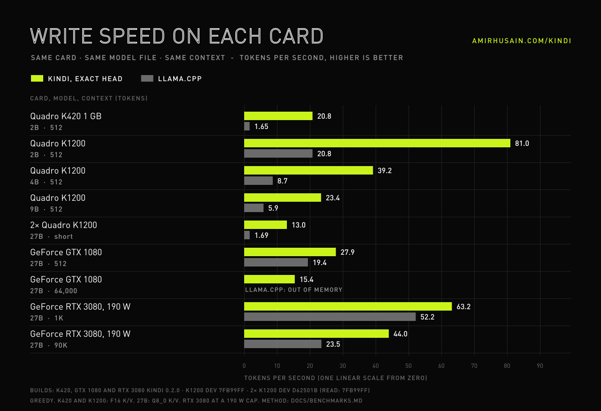

# Why Kindi

**A modern 2-billion-parameter language model that runs at 20+ tokens per second on a ten-year-old, 1 GB,
entry-level graphics card.**

The NVIDIA Quadro K420 is a 2014 workstation card. It has one Kepler multiprocessor, 192 CUDA cores, 1 GB of DDR3
and about 24 GB/s of usable memory bandwidth. Modern inference stacks have left it behind. Recent CUDA releases
dropped Kepler, and general-purpose engines that still run on it are very slow. We wrote Kindi from scratch for
exactly this chip.

| On one Quadro K420, Ternary-Bonsai-2-2B | generation speed | prompt speed |
|---|---|---|
| llama.cpp (Vulkan build, all layers on the GPU) | 2.8 tokens/s | 3.0 tokens/s |
| **Kindi 0.1.0** | **20.8 tokens/s** (exact) - **23 tokens/s** (fast head) | **26.5 tokens/s** |

Kindi is about **7x faster than llama.cpp when it generates text and 9x faster when it reads a prompt**. Both
engines use the same card and the same model file. Kindi's default output is also **token-for-token identical to llama.cpp's**
(`kindi verify` checks it). We searched and found no published result that shows any modern language model on a K420
at anything close to this speed (see [docs/BENCHMARKS.md](docs/BENCHMARKS.md)).

## What you get

- **A real model, not a toy.** Prism ML's Ternary-Bonsai-2-2B (Qwen3.5-2B architecture, ternary weights, Apache 2.0):
  chat, tool calls, code, and 24,576 tokens of context on a 1 GB card.
- **A drop-in OpenAI API.** `kindi serve` speaks `/v1/chat/completions` with streaming and tool calls. Code agents,
  chat UIs and scripts that talk to OpenAI work unchanged. Everything stays local: nothing leaves the machine.
- **Built for agents.** Kindi has a three-level prompt cache: checkpoints, parked conversations, and saved openings on
  disk. With this cache, Kindi reads an agent's 5,000-token system prompt once, not on every turn - even across
  restarts.
- **Exact by default, faster on request.** One command switches to the shortlist output head (~15 % faster,
  99.4 % identical greedy tokens) and back, without a restart.
- **Small and self-contained.** One Python package, one CUDA file, three commands: `convert`, `verify`, `serve`.

## How

Kindi treats the K420's real bottleneck - not memory bandwidth but the load/store unit of its single multiprocessor -
as the design constraint. Kindi never unpacks the ternary weights. Every 4 weights are one byte, and that byte
indexes a lookup table of precomputed partial sums. Kindi arranges these tables so that no two threads ever collide in
shared memory.

Kindi fuses the normalisation, Hadamard rotation and activation steps. Attention reads its fp16 cache once per KV
head. Kindi keeps checkpoints of the recurrent layers, so it can resume prompts exactly. Details:
[docs/HOW-IT-WORKS.md](docs/HOW-IT-WORKS.md).

## License

Kindi is free software under the AGPL-3.0, with commercial licenses available. Individuals, researchers and people
who port Kindi to other GPUs can use, change and share it at no cost. The AGPL keeps all changes to Kindi open, also
when Kindi runs behind a network service. Companies that put Kindi in a closed product or a hosted service buy a
commercial license (see [COMMERCIAL-LICENSE.md](COMMERCIAL-LICENSE.md)).

## Who it is for

Kindi is for anyone with an old workstation, a thin client or a small server with a K420 in it. It is also for anyone
who wants proof that careful engineering still beats bigger hardware.

*[Amir Husain](https://www.amirhusain.com) - project page: [amirhusain.com/kindi](https://amirhusain.com/kindi/), launch video: [YouTube](https://youtu.be/ddAnghj8HpE). The model is
Prism ML's [Ternary-Bonsai-2-2B](https://huggingface.co/prism-ml/Ternary-Bonsai-2-2B-gguf). Thanks to them for its release.*

*Kindi takes its name from Abu Yusuf Ya'qub ibn Ishaq al-Kindi (c. 801-873), the Baghdad polymath whose work on
frequency analysis is the earliest ancestor of statistical language modelling.*
